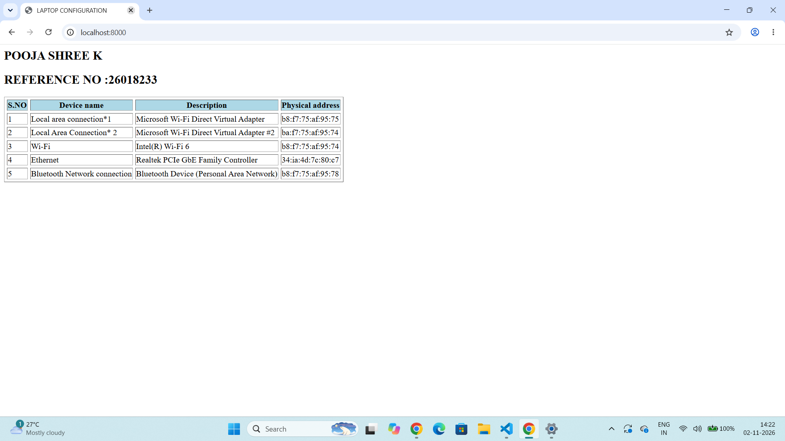
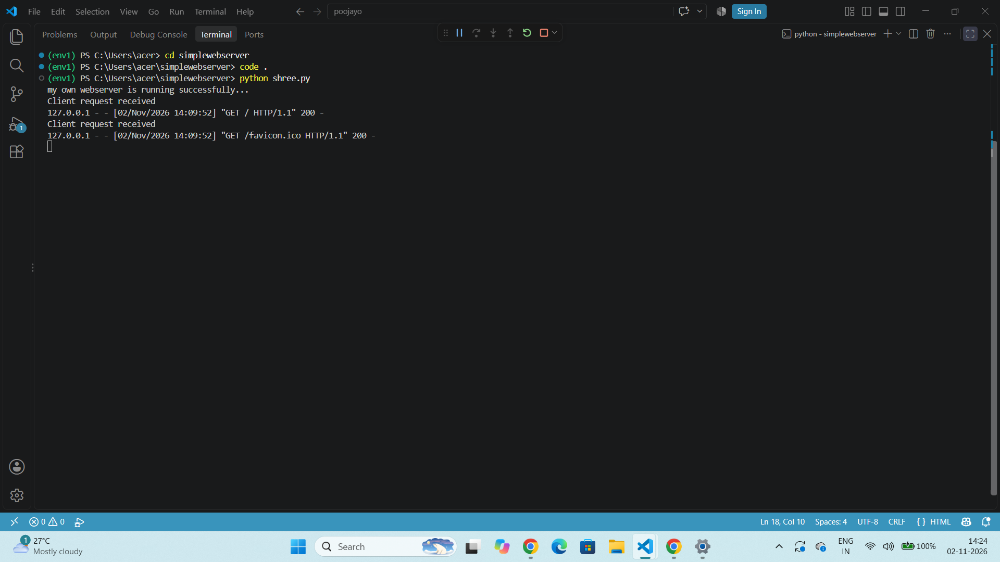

# EX01 Developing a Simple Webserver
## Date:
29/09/2026

## AIM:
To develop a simple webserver to serve html pages and display the Windows Specifications of your Laptop.

## DESIGN STEPS:
### Step 1: 
HTML content creation.

### Step 2:
Design of webserver workflow.

### Step 3:
Implementation using Python code.

### Step 4:
Import the necessary modules.

### Step 5:
Define a custom request handler.

### Step 6:
Start an HTTP server on a specific port.

### Step 7:
Run the Python script to serve web pages.

### Step 8:
Serve the HTML pages.

### Step 9:
Start the server script and check for errors.

### Step 10:
Open a browser and navigate to http://127.0.0.1:8000 (or the assigned port).

## PROGRAM:
```
shree.py
from http.server import HTTPServer, BaseHTTPRequestHandler
content = """
<html>
    <head>
        <title>LAPTOP CONFIGURATION</title>
    </head>
    <body>
        <h2>POOJA SHREE K</h2>
        <h2>REFERENCE NO :26018233</h2>
        <table border="1" cellspacing="5
        ">
<tr bgcolor="lightblue">
    <th>S.NO</th>
<th> Device name</th>
<th>Description</th>
<th>Physical address</th>
</tr>
<tr>
    <td>1</td>
    <td>Local area connection*1</td>
    <td>
        Microsoft Wi-Fi Direct Virtual Adapter
    </td><td>b8:f7:75:af:95:75
</td>
</tr>
<tr>
    <td>2</td>
<td>Local Area Connection* 2</td>
<td>Microsoft Wi-Fi Direct Virtual Adapter #2</td>
<td>ba:f7:75:af:95:74</td>
</tr>
<tr>
    <td>3</td>
    <td>Wi-Fi</td>
    <td>Intel(R) Wi-Fi 6</td>
    <td>b8:f7:75:af:95:74</td>
</tr>
<tr>
    <td>4</td>
    <td>Ethernet</td>
    <td>Realtek PCIe GbE Family Controller</td>
    <td>34:ia:4d:7c:80:c7</td>

</tr>
<tr>
    <td>5</td>
<td>
    Bluetooth Network connection
</td>
<td>
Bluetooth Device (Personal Area Network)
</td>
<td>
    b8:f7:75:af:95:78
</td></tr>

</table>
    </body>
</html>
"""
class myhandler(BaseHTTPRequestHandler):
    def do_GET(self):
        print("Client request received")
        self.send_response(200)
        self.send_header('content-type', 'text/html; charset=utf-8')
        self.end_headers()
        self.wfile.write(content.encode())
server_address = ('',8000)
httpd = HTTPServer(server_address,myhandler)
print("my own webserver is running successfully...")
httpd.serve_forever()
```

## OUTPUT:
Webpage


Server Page


## RESULT:
The program for implementing simple webserver is executed successfully.
